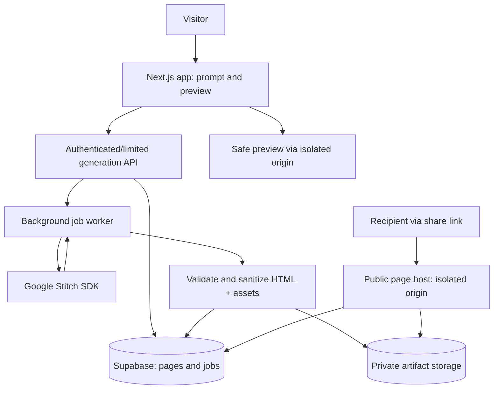

# Forgiveness — AI-Generated Apology Pages

> **Handoff blueprint for a coding agent**  
> Status: MVP specification · Updated 9 October 2026 · Owner: hobby/experimental project  
> **Mission:** Turn a short personal apology prompt into a beautiful, unique, shareable one-page website, powered primarily by Google Stitch.

## 0. Instructions to the development agent

Build a functioning, deployable MVP—not a mockup. Prioritize the full prompt → generate → review → publish → share journey. Optimize for low maintenance and low cost. Do not turn this into a general website-builder SaaS. Implement security boundaries before enabling public publishing. Keep vendor-specific logic in adapters so Stitch can be replaced without rewriting the application.

**Important compatibility note:** Stitch SDK examples on the internet differ across versions. Use the *installed version's types and README* as the source of truth. The upstream **v1 migration guide** specifies `createProject({title})`, `project.generate()` returning a `Generation` with `.first`, and `screen.getHtml()` returning **HTML content**, rather than a URL. Older documentation may describe the opposite. Pin and verify the actual package version before implementation. Do not copy old examples blindly.

## 1. Product definition

**Working title:** Forgiveness (rename freely).  
**Tagline:** “Make saying sorry a little more special.”

A visitor enters an apology idea, e.g.:

> “I forgot my girlfriend Sarah’s birthday. Make a warm, playful page with pastel colors, a cute penguin holding flowers, and a sincere apology. End with a sweet question asking if she forgives me.”

The service creates a distinctive responsive one-page design with a personalized message, a safe preview, optional simple interactions, and a public link such as `https://pages.example.com/p/a1b2c3d4`.

**MVP success condition:** A stranger can create, preview, optionally revise, publish and open a generated apology page on mobile without installing anything.

### Target users
- Couples, friends, siblings, colleagues—anyone wishing to make an apologetic or affectionate microsite.
- Creators making lighthearted, funny, romantic, or heartfelt single-use sites.

### MVP inclusion
- Prompt box with example prompts and tone options (heartfelt / cute / funny / minimalist).
- Optional recipient name, sender nickname, desired style, and primary language (English/Bahasa Melayu).
- One Stitch design generation per request, with a generation progress screen.
- Responsive preview; generated screenshot thumbnail where available.
- Ability to regenerate once or edit with a follow-up instruction (behind limits).
- Random unguessable public slug, copy-link, and social share via Web Share API.
- Content flag/report; expiration/unpublish mechanism; abuse throttling.
- No login for initial demo **if** stricter anonymous rate limits and short expiry are used.

### Not in the MVP
- Payments, subscriptions, custom domains, AI chat, template marketplace, collaboration, rich multi-page apps, arbitrary user JavaScript, recipient analytics, email/WhatsApp sending, background music uploads, or AI image/audio generation.
- Avoid building a full code-generation/hosting pipeline.

## 2. Key architectural decision

**Stitch creates a design, not a trusted production app.** Treat its HTML as untrusted generated input. Save a **sanitized, policy-checked static HTML artifact** and render/publish it from a **separate origin** with no application credentials. Do not execute arbitrary generated JS. For MVP, decorative interactions can be added from an **allowlisted, first-party enhancement library** after rendering.

If Stitch HTML requires remote libraries, untrusted `<script>` tags, forms, inline event handlers, or inaccessible external assets, the pipeline must remove/replace them, or mark the generation for retry/fallback. Never silently weaken isolation to make a design work.

### Recommended stack

| Area | Choice | Why |
|---|---|---|
| App/front end | Next.js + TypeScript + Tailwind | Familiar, fast iteration, simple deployment |
| Design engine | `@google/stitch-sdk` on **server only** | Prompt-to-UI screen, HTML and image retrieval |
| Database | Supabase Postgres | Simple record metadata, lifecycle and moderation |
| Artifact storage | Supabase Storage (private) or S3-compatible bucket | Immutable versioned HTML and preview images |
| Publishing | Dedicated page-serving subdomain or separate domain, e.g. `pages.example.com` | Origin isolation from main app |
| Validation/sanitization | HTML parser + strict allowlist sanitizer, CSP | Reduce risk of generated HTML |
| Jobs | Durable job runner/queue, or DB-backed worker for hobby scale | Generation may take longer than HTTP timeout |
| Error monitoring | Basic structured logs + optional Sentry | Trace failures without storing unnecessary sensitive content |

Do not create a separate Next.js/Vercel deployment for every generated apology. A single public-page renderer can serve saved static artifacts by slug.

### Logical architecture



**Security domains:** Main web app (`app.example.com`) and rendered pages (`pages.example.com`) must be different origins. A distinct registrable domain is preferable if practical. Never forward application cookies, auth headers, Supabase credentials, or other secrets to published pages.

## 3. User flows

### A. Create
1. Open landing page. See product promise, example gallery, prompt form.
2. Enter story/tone/name/language; submit.
3. Frontend receives `jobId`, transitions to generation progress.
4. Worker validates request and calls Stitch; save returned HTML and screenshot; process through policy checks.
5. Show safe preview from isolated host. If generation fails or is unsafe, show a helpful retry/fallback; never expose raw unsafe output.
6. User selects **Publish** → get unique share URL and copy/share controls.

### B. Revise
1. User types e.g. “Make it more playful, use purple, and add a nicer closing paragraph.”
2. Worker uses Stitch screen edit if compatible; otherwise generates a new screen from merged prompt.
3. Validate and save as a new version. Keep prior published version unchanged until user explicitly republishes.
4. Enforce low regeneration limit per anonymous session.

### C. Open a public link
1. GET `/p/:slug` on the *pages* origin.
2. Resolve published `slug`; verify `published`, `expires_at`, and moderation status.
3. Stream/copy cached sanitized HTML with hardened response headers.
4. If expired/unpublished/reported-blocked, show simple 404/gone page.

## 4. Stitch integration contract

Keep a single `DesignGenerator` interface:

```ts
export interface DesignResult {
  provider: 'stitch';
  projectId: string;
  screenId: string;
  html: string;
  screenshot?: Uint8Array;
}
export interface DesignGenerator {
  generate(input: { prompt: string; deviceType?: 'MOBILE' | 'DESKTOP' }): Promise<DesignResult>;
  revise(input: { projectId: string; screenId: string; instruction: string }): Promise<DesignResult>;
}
```

**Representative v1-style SDK pseudocode; verify against pinned package**:

```ts
import { stitch } from '@google/stitch-sdk';

export async function generateDesign(prompt: string) {
  // Keep the key in server-side environment only.
  const project = await stitch.createProject({ title: 'Forgiveness page' });
  const generation = await project.generate(prompt, { deviceType: 'MOBILE' });
  const screen = generation.first;
  const html = await screen.getHtml();   // v1: HTML string, not URL
  const screenshot = await screen.getImage(); // v1: bytes
  return { projectId: project.id, screenId: screen.id, html, screenshot };
}
```

For `revise`, use SDK methods that retrieve the project/screen and call `screen.edit(instruction)`; use its resulting `.first`. Build smoke tests at startup/CI to ensure all SDK signatures behave as expected. Avoid depending on an exact screenshot availability or shape: missing images should not block a successful HTML generation.

**Prompt construction:** Combine the user's input with project constraints, but do not silently invent personal information:

```text
Create ONE self-contained, responsive, emotionally considerate apology microsite.
Audience: recipient named {recipientName or 'my friend'}.
From: {senderName or 'someone who cares'}.
Language: {language}.
Tone: {tone}.
Personal story and content instructions: {userPrompt}.
Requirements: mobile-first; attractive typography; sincere personalized copy;
clear CTA; accessible contrast; no fake promises or coercive guilt-tripping;
no tracking, forms, third-party embeds, external scripts, or payment flows;
prefer simple HTML/CSS that works without JavaScript.
Do not include real contact information, secrets, unsafe or deceptive content.
```

User prompts are untrusted data, not instructions to disable the validation pipeline. Cap prompt length and perform server-side validation.

**Stitch product caveats:** Confirm current availability, API terms, access permissions, quotas, concurrency and pricing before relying on it; this blueprint does not assume unlimited or free API calls. Make `StitchError` failures distinguish rate limits, authorization, network failure, and invalid generation. Apply bounded retries with jitter to transient failures only; do not retry indefinitely.

## 5. API surface

| Method | Route | Input | Result |
|---|---|---|---|
| `POST` | `/api/generations` | prompt, recipientName?, senderName?, tone, language, sessionToken/captcha | `{jobId, pageId}` (202) |
| `GET` | `/api/generations/:jobId` | jobId | `{status, progressLabel, previewUrl?, error?}` |
| `POST` | `/api/pages/:id/revise` | instruction, ownershipToken | `{jobId}` (202) |
| `POST` | `/api/pages/:id/publish` | ownershipToken | `{publicUrl}` |
| `POST` | `/api/pages/:id/unpublish` | ownershipToken | confirmation |
| `POST` | `/api/pages/:slug/report` | reason | report acknowledgment |
| `GET` | `https://pages.example.com/p/:slug` | slug | published sanitized HTML |

**Ownership for anonymous MVP:** At creation, mint high-entropy edit/unpublish tokens. Store only their hash in database and pass tokens as secure, HttpOnly session cookies on the main origin (or use anonymous Supabase auth). Never expose modification tokens in the public URL, generated HTML or logs. Clear UX about losing management access if session is lost.

## 6. Minimal schema

```sql
create table pages (
  id uuid primary key default gen_random_uuid(),
  slug text unique not null,
  owner_token_hash text not null,
  prompt text not null,
  recipient_name text,
  sender_name text,
  tone text,
  language text default 'en',
  status text not null default 'draft', -- draft/published/unpublished/blocked
  active_version_id uuid,
  created_at timestamptz not null default now(),
  published_at timestamptz,
  expires_at timestamptz
);

create table page_versions (
  id uuid primary key default gen_random_uuid(),
  page_id uuid not null references pages(id) on delete cascade,
  version integer not null,
  stitch_project_id text,
  stitch_screen_id text,
  html_storage_key text,
  screenshot_storage_key text,
  validation_status text not null default 'pending',
  created_at timestamptz not null default now(),
  unique(page_id, version)
);

create table generation_jobs (
  id uuid primary key default gen_random_uuid(),
  page_id uuid not null references pages(id) on delete cascade,
  version_id uuid references page_versions(id),
  status text not null default 'queued', -- queued/running/succeeded/failed
  attempts int not null default 0,
  error_code text,
  created_at timestamptz not null default now(),
  finished_at timestamptz
);

create table page_reports (
  id uuid primary key default gen_random_uuid(),
  page_id uuid not null references pages(id) on delete cascade,
  reason text not null,
  created_at timestamptz not null default now()
);
```

Add appropriate checks, foreign keys, indexes and Row Level Security. The public page service should use a restricted server role/read path and fetch only public, approved artifacts. Do not allow clients to query prompts/private draft metadata directly.

## 7. Generated HTML safety: non-negotiable

1. **Parse HTML with a maintained library**, strip script tags, inline event attributes (`onclick`, etc.), iframes, forms, `object`, `embed`, `base`, meta refresh, SVG scripting and unsafe URL schemes (`javascript:`, `data:` where not explicitly allowed). Sanitize CSS too: disallow `@import`, unapproved `url()`, and network-exfiltrating or breaking properties where practical. Fail closed on unexpected constructs.
2. **No generated JavaScript execution in MVP.** If interactions are desired, implement vetted first-party features (e.g. hearts animation, confetti, local-only yes/no button state), inserted via trusted renderer—not from the HTML generator.
3. **Separate-origin host:** serve public pages outside the application’s cookie/auth scope. Use `Content-Security-Policy` with `default-src 'none'`, narrowly scoped `style-src`, `img-src`, `font-src`; no scripts unless explicitly loading audited first-party behavior. Consider `sandbox` CSP for public HTML, and `iframe sandbox` without `allow-same-origin` for previews where possible. Verify controls work with actual generated CSS and assets.
4. **No third-party tracking or remote images by default.** Download vetted images server-side only from explicitly approved hosts, enforce MIME/size/timeouts and SSRF defenses, then serve from isolated storage/CDN. Otherwise replace external URLs with safe placeholders.
5. Restrict file sizes, number of assets, HTML document complexity and generation runtime. Never store or execute secrets, external forms, user-uploaded executables or arbitrary custom code.
6. Use strict security response headers (`X-Content-Type-Options`, `Referrer-Policy`, cache policy); avoid sending app credentials to published pages. Add abuse checks for phishing, impersonation, harassment and threats, with report/unpublish paths.
7. Generated apology content can contain sensitive personal stories: minimize retention, avoid logging full prompts, explain data handling, set expiration, and add deletion/unpublish.
8. Protect generation endpoints with rate limits (IP + anonymous session), CAPTCHA/turnstile if abused, maximum active jobs, daily cost caps and request deduplication.

**Security acceptance test:** a malicious prompt attempting to produce a fake sign-in page, external data exfiltration, JS execution or credential capture must not result in an executable published page.

## 8. Performance, reliability, and cost guardrails

- Generation is an async **job**, not a long-held browser HTTP request. Poll job status every 2–3 seconds with backoff, or use Supabase Realtime.
- Require idempotency key on generation request; avoid duplicate provider charges from retried browser posts.
- Store artifacts once; serve published pages from edge cache/CDN. Public-page traffic should not trigger new Stitch calls.
- Start with **one generation per anonymous session/day** and **one revision** (configurable); make limits visible and adjustable. Add global daily cap and concurrency cap (e.g. 1–2) pending real quotas.
- Apply timeout, recoverable retries, dead-letter/failed job tracking and meaningful error states.
- Add daily usage counters for attempts, successes, revisions, provider errors, total storage and estimated spend. **Do not assume a per-call price until confirmed.**
- Fallback on rate limit/provider downtime: show “generation temporarily unavailable” rather than serving a broken site. Optional later template-based fallback.

## 9. Pages and UX components

**Main app routes**
- `/` landing hero + generator prompt + examples + how-it-works.
- `/create` form / generation progress.
- `/preview/:id` isolated iframe preview + revise field + publish button.
- `/manage/:id` ownership-protected unpublish and expiry settings.
- `/privacy`, `/terms`, `/report` simple policies/help.

**Public origin**
- `/p/:slug` generated site, fast on mobile, responsive and aesthetically distinctive.
- `/p/:slug` expired/removed status with non-identifying messaging.

**Visual direction:** A friendly, expressive editor—soft gradients, modern typography, minimal navigation, playful examples. Keep UI accessible and usable on small phones. Generated pages should be allowed diverse aesthetics; don't force every result into the same template.

## 10. Implementation plan / tasks

### Milestone 1 — Foundation
- [ ] Initialize Next.js TypeScript app, Tailwind, lint, tests, `.env.example`.
- [ ] Configure Supabase and schema/migrations, RLS, separate storage buckets.
- [ ] Implement anonymous ownership mechanism and rate limiting.
- [ ] Build landing page, creation form, example prompts and validation.

### Milestone 2 — Stitch proof of concept (**first integration gate**)
- [ ] Check SDK current version and API auth; set `STITCH_API_KEY` server-side.
- [ ] Build a small server-only script to create project, generate screen, fetch HTML and screenshot.
- [ ] Confirm current SDK method signatures and pin exact package version.
- [ ] Measure latency, reliability, per-request usage, output dependencies, and quota limits.
- [ ] Stop and document blocker if programmatic generation is unavailable with current account.

### Milestone 3 — Safe generation pipeline
- [ ] Implement `DesignGenerator` adapter and job worker.
- [ ] Record jobs and immutable generated versions.
- [ ] Implement sanitization/asset policy + rejection reasons + tests.
- [ ] Store sanitized HTML/screenshots and create isolated preview serving.
- [ ] Add polling/progress, errors and bounded retry UX.

### Milestone 4 — Publish and share
- [ ] Configure isolated page-serving origin and strict response headers/CSP.
- [ ] Implement publish/unpublish/expiry and unguessable public slugs.
- [ ] Add copy/share buttons, mobile preview, Open Graph metadata generated *outside* untrusted HTML.
- [ ] Protect recipient privacy in previews and link metadata.

### Milestone 5 — Revision, safety and release
- [ ] Add single prompt-based revision with the provider edit API.
- [ ] Add content reporting and manual block controls.
- [ ] End-to-end tests on desktop/mobile; malicious HTML tests; abuse tests.
- [ ] Add logs, spending guardrails, deployment README and simple runbook.

## 11. Testing checklist

- Prompt → queued → finished → preview → published link works end to end.
- English and Malay content render correctly; emojis/Unicode safe.
- Very long or empty prompt returns clear validation error.
- Browser reload during generation continues polling existing job, no duplicate request.
- Rate-limited Stitch response produces retryable status and safe UX.
- Script tags, onclick handlers, external form actions, remote images and unsafe CSS cannot survive to published artifact.
- Public page has no app cookies or session credentials; public visitors cannot mutate pages.
- Expired and unpublished slugs stop serving personalized content.
- Revision does not overwrite previous live page without user action.
- Page is attractive/readable at 375px, 768px and desktop widths; reduced-motion preference respected.
- No broken layout when a generated image asset is missing.

## 12. Definition of done

1. Deployed app lets an anonymous visitor generate one custom site from a prompt with Stitch.
2. Visitor can safely preview, revise once, and publish/share a URL.
3. Another device can open the URL without auth or generation calls.
4. Hosted output is sanitized, isolated and blocks arbitrary generated script execution.
5. Errors, expiry/unpublish, reports and rate limits function.
6. Repository includes `.env.example`, DB migrations, local setup, deploy instructions and architecture notes.
7. Agent provides actual observed Stitch quota/pricing findings and explains any restrictions or compromises.

## 13. Environment keys (example)

```dotenv
STITCH_API_KEY=
NEXT_PUBLIC_SUPABASE_URL=
NEXT_PUBLIC_SUPABASE_ANON_KEY=
SUPABASE_SERVICE_ROLE_KEY=
APP_ORIGIN=https://app.example.com
PUBLIC_PAGE_ORIGIN=https://pages.example.com
GENERATIONS_PER_SESSION_DAY=1
REVISIONS_PER_PAGE=1
GLOBAL_DAILY_GENERATION_CAP=20
# Set queue credentials and optional captcha secrets for chosen infrastructure.
```

Never expose `STITCH_API_KEY` or `SUPABASE_SERVICE_ROLE_KEY` to browser bundles.

## 14. Questions deliberately deferred

- Final brand name/domain.
- Whether to require login for pages that should stay editable beyond a browser session.
- Provider pricing and commercial limits once verified with the account.
- Separate image generation (e.g. penguins/flowers) if Stitch-generated assets aren't sufficient.
- Extra expressive interactions and optional voice/music.

## 15. Agent execution prompt (copy/paste)

> You are the lead engineer implementing the attached Forgiveness MVP blueprint. Build the real app incrementally in the current repository, favoring minimal dependencies and maintainable TypeScript. First inspect the repo; then run a Google Stitch SDK spike and verify the installed package API against its README/types, including authenticated project creation, prompt generation, HTML retrieval and optional screenshots. Build the safe async generation pipeline, isolated preview/public HTML serving, Supabase persistence, throttling, and publish/revise flows. Follow the security constraints strictly; never execute AI-generated JavaScript on the app origin. Include migrations, env examples, tests, README and deploy instructions. Run available checks and report functioning routes, exact setup steps, blockers, costs/quotas requiring account verification and any incomplete items. Don't substitute static mockups for the generation path unless external credentials are unavailable, in which case create a clearly marked mock provider for local testing.

## 16. Source references / verification notes

Consult upstream before coding, as this ecosystem evolves quickly:

- [Google Labs Stitch SDK repository](https://github.com/google-labs-code/stitch-sdk)
- [SDK package README](https://github.com/google-labs-code/stitch-sdk/blob/main/packages/sdk/README.md)
- [SDK migration to v1](https://github.com/google-labs-code/stitch-sdk/blob/main/MIGRATION-1.0.md)
- [Official repo SDK usage skill](https://github.com/google-labs-code/stitch-sdk/blob/main/.agents/skills/stitch-sdk-usage/SKILL.md)

**Verified from source review on 9 Oct 2026:** Repo documentation describes project creation, text-to-UI screen generation, HTML and screenshot retrieval, and screen editing. The v1 migration guide specifies revised API signatures. Actual account-level service access, live quotas and pricing still require verification; the repo includes a disclaimer that the SDK is not an officially supported Google product.
